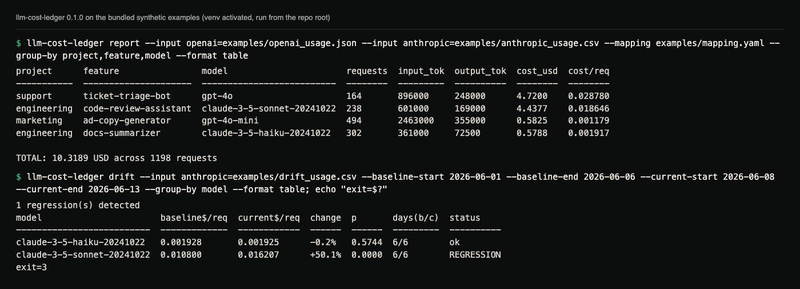
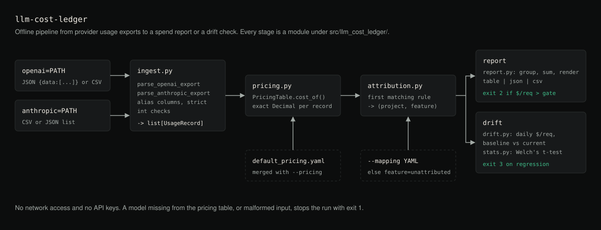

# llm-cost-ledger

Attribute LLM API spend per project, feature and model from provider usage
exports, and flag cost-per-request regressions only when they are
statistically significant and large enough to matter.

**Status:** version 0.1.0, a working command-line tool with 135 offline tests
and CI on Linux, macOS and Windows (Python 3.10 to 3.13). It is not published
to PyPI; install it from a clone. The bundled price table covers ten older
OpenAI and Anthropic models only (see [Pricing](#pricing---pricing-configyaml)).

## What

Teams that use more than one LLM provider get one opaque invoice per
provider and no answer to two basic questions:

* "Which feature cost us money last month?"
* "Did our cost per request get worse when we changed that prompt or
  switched models?"

`llm-cost-ledger` is a small, offline command-line tool that ingests the
usage export files providers already let you download (CSV/JSON), attributes
the spend to your own projects and features via a mapping-rule file, prices
it with a pricing table you can override, and can compare cost-per-request
between two time periods to flag statistically meaningful regressions.

## Why

* **No network calls, no API keys.** It only ever reads files you already
  exported. This means it works in CI, works offline, and can never leak a
  credential because it never holds one.
* **Provider invoices aggregate by account, not by feature.** Attribution
  happens locally, against identifiers *you* define, from data *you*
  control.
* **"Cost went up" is not the same as "cost regressed."** Day-to-day cost
  per request is noisy. This tool uses Welch's t-test (with a real p-value,
  not a rule of thumb) plus a minimum effect-size threshold so it only
  flags changes that are both statistically real and large enough to
  matter.

## Demo



Real output of the two commands in [Examples](#examples), run on the
synthetic files in `examples/`. The report attributes spend to the
project and feature tags from `examples/mapping.yaml`; the drift run flags
the Sonnet group and exits 3. The copyable commands and text output are in
that section.

## Features

* Ingests two provider export shapes out of the box:
  * **OpenAI-style** usage export (JSON with a `data` list, or an equivalent
    CSV): `start_time`, `model`, `n_requests`, `n_context_tokens_total`,
    `n_generated_tokens_total`, `project_id`, `api_key_id`.
  * **Anthropic-style** usage/cost export (CSV, or an equivalent JSON list)
    with `date`, `workspace_id`, `model`, `input_tokens`, `output_tokens`,
    `cache_creation_input_tokens`, `cache_read_input_tokens`,
    `request_count`.
  * Both parsers accept a handful of alias column/field names so minor
    schema drift doesn't break ingestion; anything genuinely unrecognised
    raises a clear error instead of silently dropping rows.
* Normalises everything into one internal record shape before pricing or
  attribution ever runs.
* A bundled default pricing table (USD per 1M input/output tokens, with
  optional cache-read/cache-write rates), fully overridable by your own
  YAML file. **Prices change, so always check your provider's current
  pricing page.** See [Configuration](#configuration).
* Attribution via a mapping-rule file: glob-style rules match on provider,
  model, and the provider's own project/workspace/api-key identifiers, and
  assign a `project` and `feature` tag. Unmatched records still show up in
  reports (as `unattributed`), nothing is silently dropped.
* Drift detection: split usage into a baseline and a current period, and
  for each group (project/feature/model by default) run Welch's t-test on
  the *daily* cost-per-request series in each period. A group is only
  reported as a regression if the increase is both statistically
  significant (`--alpha`, default 0.05) **and** large enough to matter
  (`--min-relative-increase`, default 10%). Decreases are never flagged.
  Groups without enough daily data points (`--min-days`, default 3) are
  reported as "insufficient data", never silently treated as "no change".
* Three output formats for every report: `table` (human), `json`, `csv`.
* CI-friendly exit codes: `report --max-cost-per-request` gates a build on
  spend, `drift` gates a build on detected regressions.

## Architecture



*Diagram of the modules a `report` or `drift` run passes through.*

```
provider export file(s)
        |
        v
  llm_cost_ledger.ingest       parse_openai_export / parse_anthropic_export
        |                      -> list[UsageRecord]  (one internal shape)
        v
  llm_cost_ledger.pricing      PricingTable.cost_of(record) -> USD
        |
        v
  llm_cost_ledger.attribution  AttributionRules.attribute(record)
        |                      -> (project, feature)
        v
  list[AttributedRecord]
        |
        +---> llm_cost_ledger.report   aggregate + render (table/json/csv)
        |
        +---> llm_cost_ledger.drift    detect_drift(baseline, current)
                                        -> llm_cost_ledger.stats.welch_t_test
```

Each module is independently unit-tested and has no knowledge of the CLI;
`llm_cost_ledger.cli` is a thin argument-parsing layer over the library.

## Installation

Requires Python 3.10 or newer. The only runtime dependency is PyYAML.

```bash
git clone https://github.com/hellpuffyt/llm-cost-ledger.git
cd llm-cost-ledger
python -m venv .venv
# Windows
.venv\Scripts\python.exe -m pip install -e ".[dev]"
# macOS/Linux
.venv/bin/python -m pip install -e ".[dev]"
```

This installs the `llm-cost-ledger` console script into the venv
(`.venv/bin/llm-cost-ledger`, or `.venv\Scripts\llm-cost-ledger.exe` on
Windows). Activate the venv, or call the script by that path, to run the
examples below. `pip install .` without `-e ".[dev]"` gives you just the CLI.

## Usage

```
llm-cost-ledger ingest --input openai=usage.json
llm-cost-ledger report --input openai=usage.json --input anthropic=usage.csv \
    --mapping mapping.yaml --group-by project,feature,model --format table
llm-cost-ledger drift --input anthropic=usage.csv \
    --baseline-start 2026-06-01 --baseline-end 2026-06-06 \
    --current-start 2026-06-08 --current-end 2026-06-13
```

`ingest` prints the normalised records as JSON, which is useful for checking
how a new export file was parsed. `report` and `drift` do the pricing and
attribution.

| Option | Applies to | Meaning |
|--------|------------|---------|
| `--input PROVIDER=PATH` | all | Repeatable. Provider is `openai` or `anthropic`. |
| `--output PATH` | all | Write to a file instead of stdout. |
| `--pricing PATH` | report, drift | Pricing YAML merged over the bundled table. |
| `--mapping PATH` | report, drift | Attribution rules. Without it every record is `unattributed`. |
| `--group-by` | report, drift | Comma-separated. `report`: `project,feature,model,provider,day`. `drift`: the same without `day`. Default `project,feature,model`. |
| `--format` | report, drift | `table` (default), `json` or `csv`. |
| `--start-date`, `--end-date` | report | Inclusive `YYYY-MM-DD` filter. |
| `--max-cost-per-request USD` | report | Exit 2 if any group exceeds it. |
| `--baseline-start/-end`, `--current-start/-end` | drift | Required, inclusive dates. The periods must not overlap. |
| `--alpha`, `--min-relative-increase`, `--min-days` | drift | Defaults `0.05`, `0.10`, `3`. |

### Exit codes

| Code | Meaning |
|------|---------|
| 0 | success, no gate breached |
| 1 | usage error (bad arguments, unparsable input, bad config) |
| 2 | `report --max-cost-per-request` gate breached |
| 3 | `drift` found one or more statistically meaningful regressions |

## Examples

Sample export files, a mapping file, and a pricing override live in
[`examples/`](examples/). With the package installed:

```bash
llm-cost-ledger report \
  --input openai=examples/openai_usage.json \
  --input anthropic=examples/anthropic_usage.csv \
  --mapping examples/mapping.yaml \
  --group-by project,feature,model \
  --format table
```

```
project      feature                model                       requests  input_tok  output_tok  cost_usd  cost/req
-----------  ---------------------  --------------------------  --------  ---------  ----------  --------  --------
support      ticket-triage-bot      gpt-4o                      164       896000     248000      4.7200    0.028780
engineering  code-review-assistant  claude-3-5-sonnet-20241022  238       601000     169000      4.4377    0.018646
marketing    ad-copy-generator      gpt-4o-mini                 494       2463000    355000      0.5825    0.001179
engineering  docs-summarizer        claude-3-5-haiku-20241022   302       361000     72500       0.5788    0.001917

TOTAL: 10.3189 USD across 1198 requests
```

Gate a CI build on runaway per-request cost:

```bash
llm-cost-ledger report --input openai=usage.json --max-cost-per-request 0.05
```

Gate a CI build on cost-per-request regressions between two release
periods, comparing daily cost/request means with Welch's t-test:

```bash
llm-cost-ledger drift \
  --input anthropic=examples/drift_usage.csv \
  --baseline-start 2026-06-01 --baseline-end 2026-06-06 \
  --current-start 2026-06-08 --current-end 2026-06-13 \
  --group-by model --format table
```

`drift` also writes `1 regression(s) detected` to stderr and exits 3.

```
model                       baseline$/req  current$/req  change  p       days(b/c)  status
--------------------------  -------------  ------------  ------  ------  ---------  ----------
claude-3-5-haiku-20241022   0.001928       0.001925      -0.2%   0.5744  6/6        ok
claude-3-5-sonnet-20241022  0.010800       0.016207      +50.1%  0.0000  6/6        REGRESSION
```

## Configuration

### How costs are computed and rounded

Each record's cost is computed exactly in decimal arithmetic
(`tokens x rate / 1,000,000`) and sums use `math.fsum`, so totals match a
hand calculation. Displayed amounts are rounded half-up (`0.58245` prints as
`0.5825`). Cache-read and cache-write tokens use their own rates when the
pricing entry has them (including an explicit `0`), and the input rate
when it does not. Prices must be finite and non-negative.

Token counts must be non-negative whole numbers (`12` or `12.0`); `12.7`,
`inf` or `-5` are rejected with an error rather than truncated. A row with
tokens but a request count of `0` (or no request column) is counted as one
request so cost per request stays defined. `drift` requires the baseline and
current periods not to overlap.

### Pricing (`--pricing config.yaml`)

Values in your file override the bundled default table
(`src/llm_cost_ledger/data/default_pricing.yaml`) per-model; models you do
not mention still fall back to the default. Rates are USD per 1,000,000
tokens.

Model names are matched exactly. The bundled table has `gpt-4o`,
`gpt-4o-mini`, `gpt-4-turbo`, `gpt-3.5-turbo`, `o1`, `o1-mini`,
`claude-3-5-sonnet-20241022`, `claude-3-5-haiku-20241022`,
`claude-3-opus-20240229` and `claude-3-haiku-20240307`. Any other model in
an export (a newer model, or a dated snapshot name) stops `report` and
`drift` with exit 1:

```
error: no price entry for model 'claude-sonnet-4-5'. Add it to a --pricing config file (see README Configuration section).
```

Add those models to your override file.

```yaml
models:
  gpt-4o-mini:
    input_per_million: 0.20
    output_per_million: 0.80
  my-internal-finetune:
    input_per_million: 1.00
    output_per_million: 2.00
    cache_read_per_million: 0.10   # optional
    cache_write_per_million: 1.25  # optional
```

**Prices change.** The bundled table is a snapshot taken at publish time.
Always check your provider's current pricing page before trusting a dollar
figure this tool prints for anything that matters, and keep your own
override file up to date.

### Attribution (`--mapping mapping.yaml`)

Rules are evaluated top to bottom; the first rule whose `match` clauses all
match (case-insensitive glob patterns) wins. Matchable fields: `provider`,
`model`, `raw_project_id` (OpenAI `project_id` / Anthropic `workspace_id`),
`raw_api_key_id` (OpenAI `api_key_id`).

```yaml
rules:
  - match:
      provider: openai
      raw_project_id: "proj_marketing"
    tags:
      project: marketing
      feature: ad-copy-generator
  - match:
      provider: anthropic
      model: "claude-3-5-sonnet*"
    tags:
      project: engineering
      feature: code-review-assistant
```

Records matching no rule are still reported, tagged with
`project=<their raw provider id>` and `feature=unattributed`, so spend
never silently disappears from a report.

## Testing

```bash
# macOS/Linux (on Windows use .venv\Scripts\python.exe)
.venv/bin/python -m pytest
.venv/bin/python -m ruff check .
.venv/bin/python -m mypy src tests
```

All 135 tests run offline against fixture files in `examples/` and
`tests/`; nothing in the test suite makes a network call or reads an API
key. CI (`.github/workflows/ci.yml`) runs pytest on Linux, macOS and Windows
for Python 3.10 to 3.13, ruff and strict mypy, and a smoke job that installs
the package into a fresh venv and checks that the report gate exits 2 and the
drift example exits 3.

## Limitations

* Only the two export shapes above are parsed. Other providers need a new
  parser in `ingest.py`.
* Drift compares daily means, so it needs at least `--min-days` days with
  traffic in each period. Rows are bucketed by their `date` field.
* The bundled prices are a snapshot and will go stale; treat dollar figures
  as estimates until you have checked them against your own price file.
* Only increases are flagged. A drop in cost per request is reported as
  `ok`.

## Security

* This tool never makes a network request and never reads or stores an API
  key. It only reads local export files you point it at. YAML is loaded
  with `yaml.safe_load`.
* Only synthetic, fabricated data is used in tests and examples; no real
  usage exports, account identifiers, or credentials are included in this
  repository.
* Input parsing raises clear errors on malformed data rather than guessing;
  malformed CSV/JSON should never crash with a stack trace an end user
  can't act on. Please open an issue if you find one that does.

Report vulnerabilities privately as described in [SECURITY.md](SECURITY.md).

## Contributing

See [CONTRIBUTING.md](CONTRIBUTING.md) for the setup and the checks to run
before a pull request. Changes are recorded in [CHANGELOG.md](CHANGELOG.md).

## License

MIT. See [LICENSE](LICENSE).
